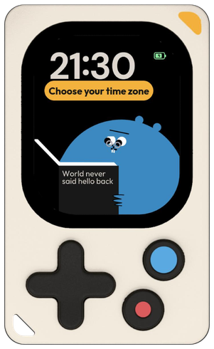
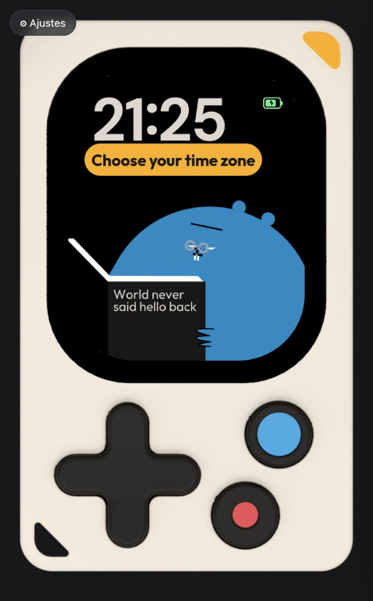
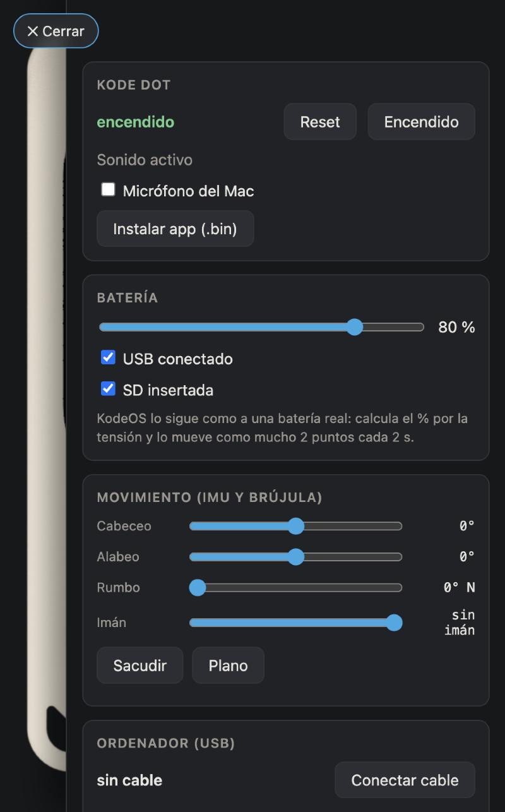

<div align="center" markdown="1">



# kode-sim

**The Kode Dot simulator: kodeOS and your apps, without the board**

[](https://github.com/espressif/esp-emulator)
[](https://github.com/espressif/esp-idf)

[](LICENSE)

[The guide](docs/GUIDE.md) ·
[Roadmap](docs/ROADMAP.md) ·
[kode-sdk](https://github.com/kodediy/kode-sdk) ·
[kodeOS](https://github.com/kodediy/KodeOS) ·
[Discord](https://discord.gg/gZSNXRytFV)

</div>

---

kode-sim runs the Kode Dot's firmware on your computer. It builds kodeOS or any [kode-sdk](https://github.com/kodediy/kode-sdk) app, boots it in Espressif's ESP32-P4 emulator, `esp-emu`, and opens the Kode Dot in a window: the screen and touch, the six buttons, the LED, the vibration, the speaker and the microphone, the battery, the microSD, the motion sensors and the USB port.

The firmware is the real one: FreeRTOS, QP/C, the Active Objects and Kode's drivers, run instruction by instruction on an emulated P4. You do not change your app to run it here: an app on kode-sdk 0.1.1 or newer builds and runs as it is.

```bash
git clone https://github.com/kodediy/kode-app-template.git
kode-sim run kode-app-template
```

<p align="center">
  
  &nbsp;&nbsp;
  
</p>

The window shows only the Kode Dot. Click the screen to touch it, click the buttons or use the keys: <kbd>T</kbd> for the top button, <kbd>B</kbd> for the bottom one, the arrows for the D-pad. **Ajustes** (Settings) opens the rest: the battery, the USB cable, the microSD, motion, a computer on the USB port, installing an app and the console. The page is in English and Spanish: it follows the browser's language, and the **ES | EN** switch at the bottom of that panel changes it (remembered).

## One simulator for everyone

Several people in the [Discord](https://discord.gg/gZSNXRytFV) are writing their own Kode Dot simulators. Let's build one, here. If you are working on a part of the Kode Dot (a chip, the screen, a tool), [open an issue with "I want to work on this"](https://github.com/kodediy/kode-sim/issues/new/choose) first: we will say where it fits and nobody will start the same thing twice. The [status](#status) below says what is done and what is left.

## Status

kode-sim 0.2.0 runs on esp-emu 1.0.0. What the emulator does not have yet, `kemu` does from inside the firmware: a small component that `kode-sim build` links into the app. Each part that esp-emu gains leaves kemu. When kemu is empty, the same binary will run on the board and in the simulator.

| Part of the Kode Dot | Today | Waits for |
|---|---|---|
| ESP32-P4, 32 MB flash, 32 MB PSRAM | ✅ esp-emu | |
| Buttons, touch, LED, vibration, charger and gauge | ✅ chips modelled by kode-sim | |
| Speaker and microphone (ES8311) | ✅ esp-emu's I2S, through your computer's speaker and microphone | |
| IMU and magnetometer | ✅ posed from the window: tilt, heading, a shake, a magnet | |
| Screen (MIPI-DSI, 410×502) | 🟡 kemu | DSI in esp-emu ([esp-emulator#5](https://github.com/espressif/esp-emulator/issues/5)) |
| microSD | 🟡 kemu, a card image on your computer | SDMMC in esp-emu ([esp-emulator#33](https://github.com/espressif/esp-emulator/issues/33)) |
| WiFi | 🟡 kemu: a network through your computer | the ESP32-C5 in esp-emu ([esp-emulator#48](https://github.com/espressif/esp-emulator/issues/48)) |
| USB port | 🟡 kemu, with a simulated computer: its disk and its keyboard | a USB host in esp-emu ([esp-emulator#51](https://github.com/espressif/esp-emulator/issues/51)) |
| Bluetooth, Wi-Fi scans, infrared | ❌ | the ESP32-C5 in esp-emu |
| NFC, 125 kHz RFID | ❌ absent, as on a board without them | |
| JPEG and PPA, light sleep | ❌ done in software, or not at all | esp-emu ([esp-emulator#5](https://github.com/espressif/esp-emulator/issues/5)) |
| Speed | 🟡 half to full real time on an Apple M-series Mac, slower on smaller computers: the emulator runs on one core; [`kode-sim bench`](docs/GUIDE.md#measuring-speed-kode-sim-bench) measures yours | [esp-emulator#53](https://github.com/espressif/esp-emulator/issues/53) |

✅ works · 🟡 works, through a stand-in or with limits · ❌ not yet

**What is planned.** The next releases each take a piece out of kemu, as esp-emu gains it: the screen (0.3.0), the microSD (0.4.0), the ESP32-C5 (0.5.0), and then 1.0.0, where the official images and the apps from [apps.kode.diy](https://apps.kode.diy) boot unchanged. The [roadmap](docs/ROADMAP.md) has the details and the open requests to Espressif.

**Today, an app runs here when you build it from its source** with `kode-sim build` or `kode-sim run`. A binary built for the board (from apps.kode.diy, for example) does not run yet: it waits for the screen in esp-emu.

## Install

kode-sim is made for macOS on Apple silicon. It also builds and runs firmware on Linux: tried on Debian 12, x86_64 (see [Linux](docs/GUIDE.md#linux) in the guide).

1. **ESP-IDF v6.1**, the version kodeOS is built with, installed in `~/.espressif` with Espressif's installer.
2. **Rust**, stable, from [rustup.rs](https://rustup.rs).
3. **Google Chrome or Microsoft Edge**, for the simulator's window. Without them, the Kode Dot opens in your usual browser.
4. **kode-sim**, built from this repository:

```bash
git clone https://github.com/kodediy/kode-sim.git
cd kode-sim
cargo build --release
ln -sf "$PWD/target/release/kode-sim" ~/.local/bin/kode-sim
```

- Keep the folder where it is: kode-sim uses its `web/` and `firmware/`.
- On its first run, kode-sim installs esp-emu 1.0.0 with Espressif's installer, in its own cache.
- On Linux, install `rsync` and `mtools` too (Debian/Ubuntu: `sudo apt install rsync mtools`): kode-sim copies the project with rsync and makes the microSD image with mtools.

## Use

```bash
kode-sim run ~/my-app                                  # an app in the window
kode-sim run --sdk ~/kode-sdk ~/kode-sdk/examples/display_lvgl   # a kode-sdk example, against that kode-sdk
kode-sim run ~/KodeOS                                  # kodeOS (see below)
kode-sim install ~/my-app                              # build an app and install it in the running kodeOS
kode-sim build ~/my-app                                # only build it
kode-sim review my-app.bin                             # boot it headless and check it, with a verdict
```

- `kode-sim run` builds the project for the simulator (your folder is never touched: it builds a copy in its cache), boots it and opens the window. Closing the window stops it.
- The terminal that runs kode-sim is the Kode Dot's console too: type `help`.
- **kodeOS:** the simulator builds it without the radio, and kodeOS does not build that way yet. Until [KodeOS#67](https://github.com/kodediy/KodeOS/issues/67) is merged, apply the small change that issue describes to your clone of KodeOS first.

[The guide](docs/GUIDE.md) explains every command and option, the network, the microSD, installing apps, reviews, motion and the USB port.

## How it works

```
 ┌──────────────── esp-emu (ESP32-P4) ──────────────┐            ┌────────── kode-sim (Rust) ─────────┐
 │ your app / kodeOS        (unchanged)             │            │ the board's chips (kodedot-chips)  │
 │ kode.h → Active Objects → kdrv (unchanged)       │ cosim-tcp  │  TCA6408A, CST820, KTD2026,        │
 │ I2C, GPIO, I2S ──────────────────────────────────┼────────────┤  AW86233, BQ25896, CW2217, ES8311, │
 │                                                  │            │  QMI8658A, QMC5883P                │
 │ kemu: screen, microSD, C5, USB, console ─────────┼── UART1 ───┤ bridge: the window, the console,   │
 │       (what esp-emu does not have yet)           │            │  the microSD image, the USB host   │
 └──────────────────────────────────────────────────┘            └────────────────────────────────────┘
```

- **The chips** of the board are modelled in Rust (`crates/kodedot-chips`). They answer the P4's I2C and drive its pins through esp-emu's co-simulation bus, as the real chips answer kode-sdk's drivers.
- **kemu** (`firmware/kemu`) stands in for the parts esp-emu does not have yet. It replaces a few driver calls when the app is linked, and talks to kode-sim over a UART.
- **The window** (`web/`) is a page that kode-sim serves, connected by a WebSocket.

## Layout

| Folder | What it holds |
|---|---|
| `crates/kode-sim/` | the `kode-sim` command: build, run, install, review, and the bridge to the window |
| `crates/kodedot-chips/` | the board's chips, modelled |
| `crates/cosim/` | the client of esp-emu's co-simulation bus |
| `firmware/kemu/` | the stand-ins linked into the firmware |
| `web/` | the window: the page, the Kode Dot's picture, the audio |
| `tests/` | the host suites and the emulator suite |
| `docs/` | [the guide](docs/GUIDE.md), [the roadmap](docs/ROADMAP.md), [how a release is made](docs/RELEASING.md) |

## Contributing

1. Tell us what you want to build in an issue ([I want to work on this](https://github.com/kodediy/kode-sim/issues/new/choose)), or pick an open one.
2. Run the host suites before a pull request: `tools/host_tests.sh` (Rust, the command from outside, the page, kemu's C). The emulator suite, `pytest -m emu tests`, boots real firmware: run it when your change reaches the firmware.
3. Name the pull request in the commit format, `type(scope): Summary`, and fill in its template.

The [CHANGELOG](CHANGELOG.md) says what each release changed. Kode's [contributing guide](https://github.com/kodediy/.github/blob/main/CONTRIBUTING.md) and [code of conduct](https://github.com/kodediy/.github/blob/main/CODE_OF_CONDUCT.md) apply here.

## Licence

kode-sim is free software. Its licence is the GNU General Public License, version 3 or later. The file [LICENSE](LICENSE) holds the full text, and [NOTICE.md](NOTICE.md) says what each part is under, the trademarks, and what kode-sim downloads.
